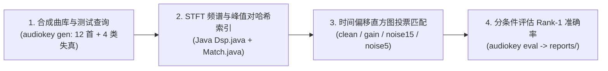

# audiokey

[English](README.md) | [简体中文](README.zh-CN.md)

**从 5 秒含噪音频片段中精准识别曲目。** `audiokey` 通过频谱峰值对构建声学指纹索引，并将查询片段投票到 `(track, time-offset)` 二维偏移空间，按不同失真条件（干净、增益变化、15 dB 噪声、5 dB 强噪声）分别报告 Rank-1 识别率——因为只看平均值会掩盖系统真正的薄弱环节。

```console
$ python scripts/demo.py
audiokey 0.1.0  12 tracks  60 queries
accuracy 80.0% (48/60)  median latency 11.1 ms  margin 1.63x
  clean    24/24  100%
  gain     12/12  100%
  noise15  7/12  58%
  noise5   5/12  42%
```

## 操作工作流与流程图



## 工作原理

| 阶段 | 实现细节 |
| --- | --- |
| 音频解析 | 8 kHz、16-bit 单声道 WAV，手写解析（不依赖 `javax.sound`） |
| 频谱变换 | 512 点 Hann 窗、128 点步长、基 2 FFT、对数幅度谱 |
| 峰值提取 | 5×5 邻域局部极大值，帧内自适应阈值，每帧最多取 6 个峰值 |
| 哈希编码 | 取 1 秒及 40 个频点范围内的峰值对，打包为一个整数哈希 |
| 索引结构 | `hash → (track, frame)` 列表 |
| 匹配投票 | 统计 `track_frame − query_frame` 差值直方图，最高票桶胜出 |

**为什么哈希“峰值对”而不是单个峰值**：音量增益变化会等比缩放所有幅度，但两个峰值之间的时间差和频率差保持不变；再利用时间偏移直方图投票，真实的匹配会集中落在同一个偏移桶里，而偶然碰撞会分散开来。

## 实测结果

12 首 20 秒曲目、60 条查询片段（每种失真条件 12 条），单 JVM 无 GPU：

| 查询时长 | 总准确率 | 干净 (Clean) | 增益变化 (Gain) | 15 dB 噪声 | 5 dB 噪声 |
| --- | --- | --- | --- | --- | --- |
| 3 s | 76.7% | 24/24 | 12/12 | 6/12 | 4/12 |
| 5 s | 80.0% | 24/24 | 12/12 | 7/12 | 5/12 |
| 8 s | 85.0% | 24/24 | 12/12 | 10/12 | 5/12 |

索引规模：12 首曲目共 73,245 条哈希，构建耗时 0.26 秒；5 秒查询中位延迟 11 ms，8 秒查询 18 ms。

## 被实测淘汰的方案（负结果记录）

- **频谱白化（Spectral whitening）**：减去每个频点随时间的中位数后，虽然去除了平稳噪声，但也抹掉了持续和弦音，5 秒准确率从 `0.800` 跌至 `0.700`，已回退。
- **频率量化减半（Frequency quantisation）**：将频点索引除以 2 以吸收 ±1 bin 漂移，结果 5 秒跌至 `0.717`、8 秒跌至 `0.833`，同样回退。

## 快速开始与分步工作流

```bash
# 一键运行完整流水线
python scripts/demo.py
```

分步执行：

```bash
# 1. 生成合成曲库与带标注查询片段
PYTHONPATH=python/src python -m audiokey gen --tracks 12 --clip 5   --tracks-dir data/tracks --queries-dir data/queries --truth data/truth.json

# 2. 编译并运行 Java 声学指纹索引与匹配
javac -d out java/src/audiokey/*.java
java -cp out audiokey.Match --tracks data/tracks --queries data/queries --out data/results.json

# 3. 按失真条件输出评估报告
PYTHONPATH=python/src python -m audiokey eval   --truth data/truth.json --results data/results.json --out reports
```

环境要求：JDK 22（DSP 与匹配）、Python 3.11+（数据合成与评估），Node 22.6+（可选，用于前端看板）。

## 仓库结构与已知限制

```
java/src/audiokey/Dsp.java       WAV 解析、FFT、频谱图、峰值提取与哈希
java/src/audiokey/Match.java     索引构建、偏移投票与 JSON 输出
python/src/audiokey/gen.py       曲目合成与查询集生成
python/src/audiokey/evaluate.py  分条件 Rank-1 准确率统计
web/dashboard.ts                 单文件结果看板
scripts/demo.py                  一键端到端脚本
```

- **合成曲库**：和弦旋律结构较规整，不等同于包含人声、鼓点与静音段的真实音乐。
- **8 kHz 单声道**：为了快速验证采用语音频段采样率。
- **无流式持久化**：每次运行全量重建索引，无分片与增量插入。

## 开发测试与协议

```bash
PYTHONPATH=python/src python -m unittest discover -s python/tests -t python/tests -v
cd python && pip install -e ".[dev]" && ruff check . && mypy
```

MIT，详见 [LICENSE](LICENSE)。
